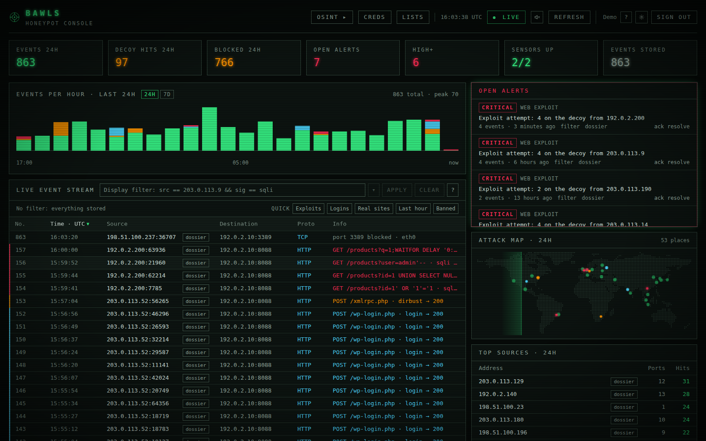
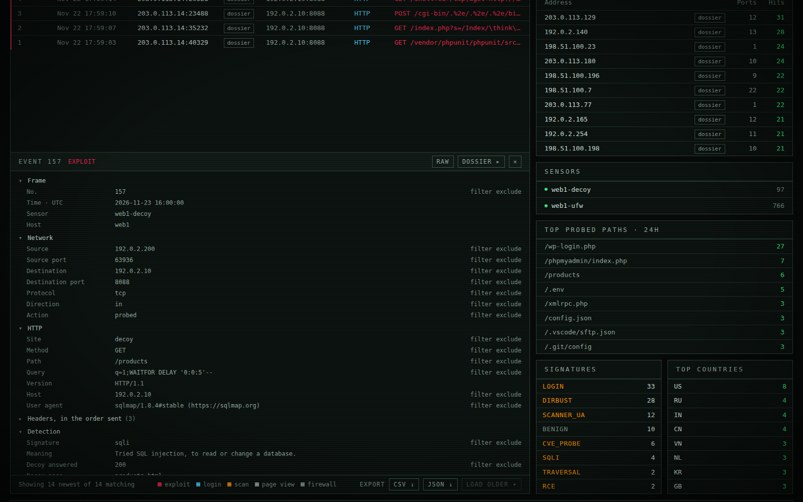
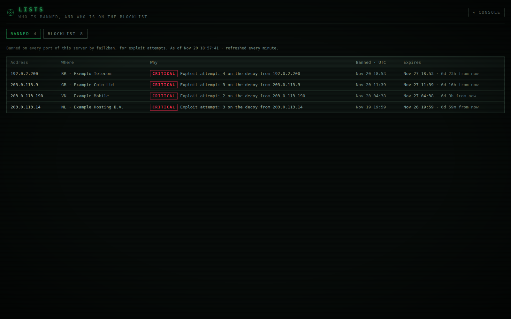
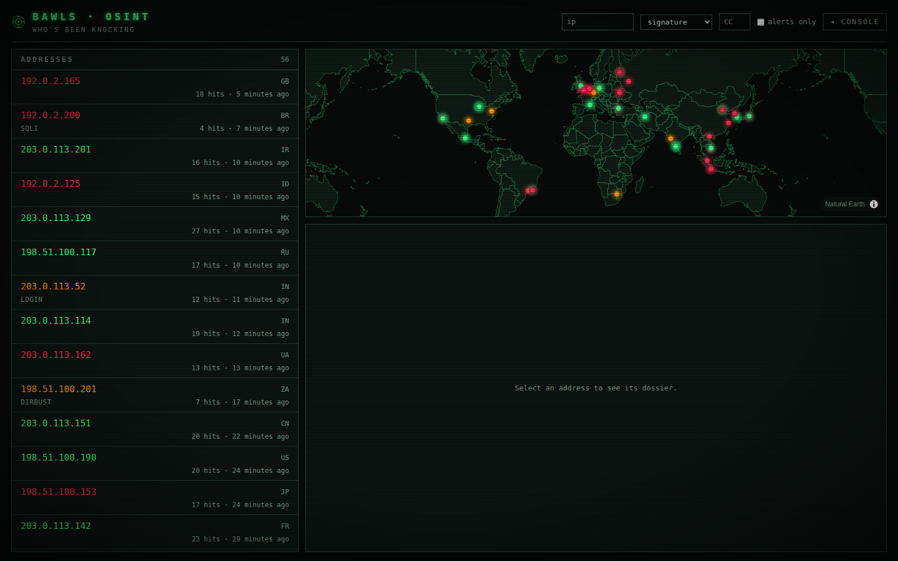
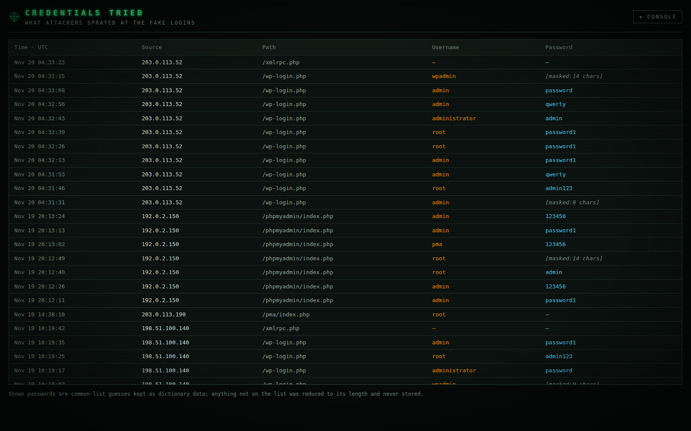
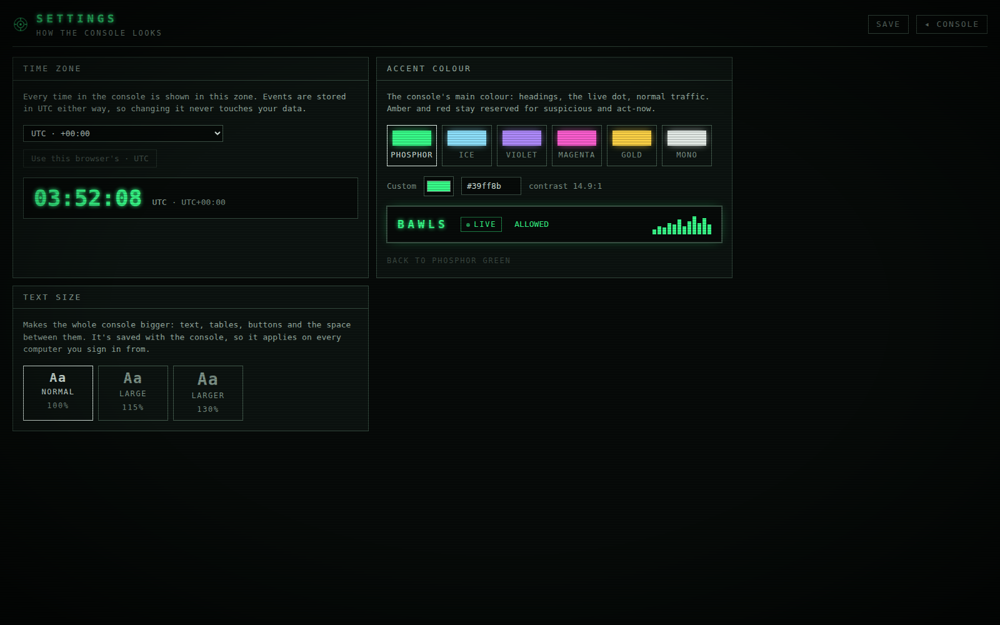
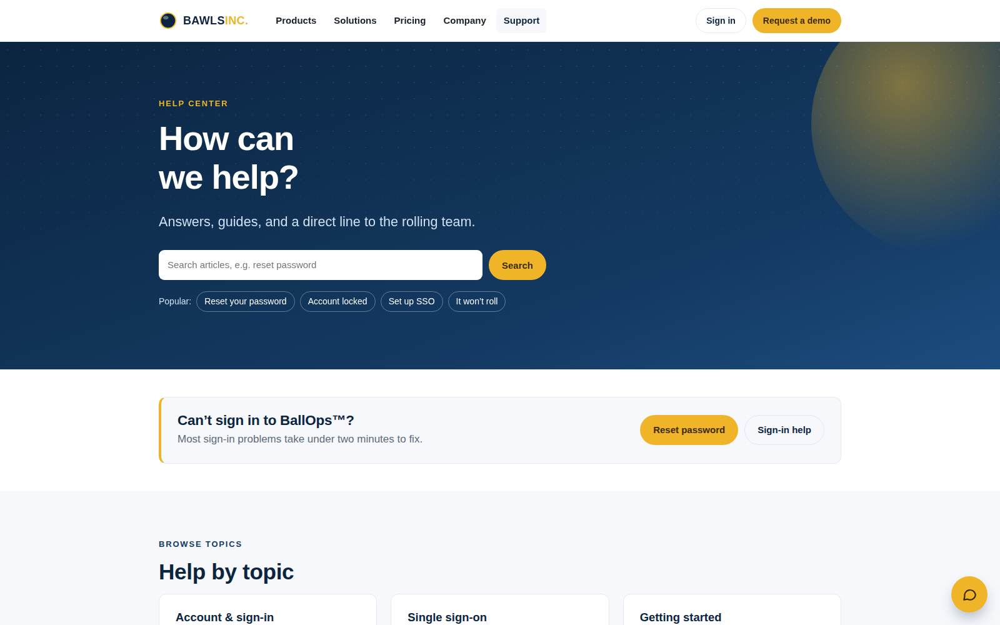
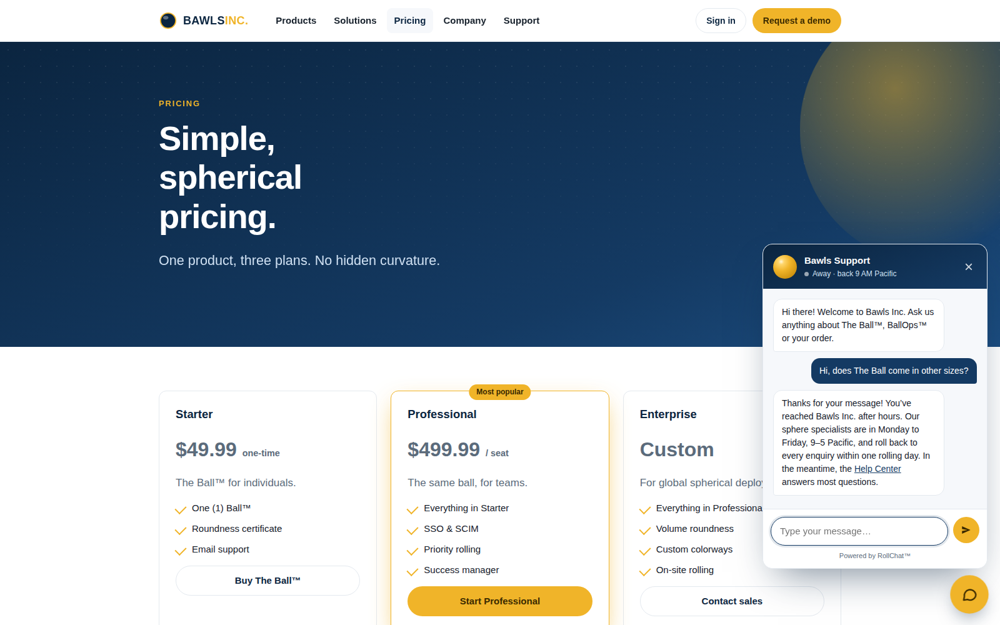

<h1 align="center">bawls</h1>

<p align="center"><strong>A decoy website that bans the attackers it catches.</strong></p>

<p align="center">
A self-hosted honeypot for any Linux server you have root on. Scanners and exploit bots that hit
your bare IP or a spare domain land on a fake company's website. bawls records what they try,
looks up who they are, and blocks the worst of them at the firewall, for every site on the server.
</p>



<p align="center"><sub>Screenshots use fictional demo data from the documentation IP ranges, not real attackers.</sub></p>

---

## What it is

Every server on the internet is probed around the clock: bots try `/.env`, WordPress logins,
phpMyAdmin, old CVEs, SQL injection, SSH passwords. Most of it lands on 404 pages and is never seen.

bawls puts something there for them to find. Requests for your server's bare IP, for unknown
hostnames, or for a domain you set aside get a convincing (and slightly absurd) corporate website,
plus fake versions of the files and logins attackers look for. Every request is recorded, with
what the client sent and what it tried. Anything that sends a real exploit is banned from the
whole server for a week, on every port, so your real sites never see it again.

It all goes into a private console only you can reach. One install script sets it all up next to
the sites you already run, on Apache or nginx.

## Features

- **A decoy that looks real**: a full fake company website (Bawls Inc.: *Global Leaders in
  Spherical Solutions*) of about thirty pages, from products and pricing to a help center, a
  customer sign-in that never lets anyone in, and an after-hours support chat. It's served to the
  bare IP, unknown hostnames, or a domain of your choice. Swap in your own theme so it looks like
  anything.
- **Bait where attackers look**: fake WordPress and phpMyAdmin logins, a leaked `.env`,
  `.git/config`, AWS keys, an SSH key, Spring actuator and server-status pages, the PHPUnit
  `eval-stdin.php` probe. All fake, and every visit is recorded.
- **Bans on every port**: an exploit attempt (SQL injection, remote code execution, path
  traversal, a known-CVE probe) gets the source banned by fail2ban for 7 days, firewall-wide.
  Your own IP and the server's addresses are never banned, and neither is a genuine search-engine
  crawler (checked by DNS, not by its user agent).
- **Your real sites, too**: optionally, bawls reads the access logs of the other websites on the
  server and bans exploit attempts there exactly as it does on the decoy. Only the attacks are
  sent to bawls; your visitors' traffic is never stored.
- **Detections**: port scans, host sweeps, floods, brute force against SSH, RDP, Telnet,
  SMB, FTP and databases, web scans and exploit attempts, raised as alerts you can
  acknowledge or resolve.
- **What the patterns missed**: a weekly digest on the overview of decoy requests that matched no
  attack pattern but look like probing, ranked by how many addresses tried each, so a new exploit
  probe stands out. See [How attacks are recognised](#how-attacks-are-recognised).
- **A Wireshark-style event stream**: every decoy request and firewall drop in one live list,
  colour-coded by what it was. Narrow it with a display filter (`src == 203.0.113.9 && sig == sqli`),
  one-click presets, or a click on any source, signature, country or hour on the chart. Open an
  event to see its request layer by layer: headers in the order sent, form fields, and what it
  was caught as. Export everything the filter matches as CSV or JSON.
- **A live attack map**: a radar-style world map of where the last 24 hours came from, each place
  coloured by the worst thing it did. New contacts ping as they arrive; click one to filter by
  its country.
- **A firewall sensor**: if UFW is on, the connections it blocks are recorded too.
- **Dossiers on attackers**: a one-line verdict up top (banned until when, how many exploit
  attempts, how long it's been around), then country, city and network from MaxMind GeoLite2
  (looked up on your server), reverse DNS, RDAP, AbuseIPDB, GreyNoise, Shodan InternetDB and the
  Tor exit list, pinned on a map that's bundled with bawls, so nothing about what you look at goes
  to a map provider.
- **What they typed**: every username and password sprayed at the fake logins. Passwords off the
  common-password list are reduced to their length and never stored.
- **A console nobody else can find**: a private hostname, an IP allowlist, a secret sign-in path
  (everything else answers 404) and a strict Content Security Policy.
- **Easy to read**: hover any signature, alert rule or colour for what it means in plain English
  and whether it bans. Times are in your own time zone, keyboard shortcuts are a `?` away, and a
  text size setting scales the whole console up to 130%.
- **Alerts you notice**: new alerts slide in with a red glow, the browser tab shows how many are
  open, and an optional chirp sounds when one arrives. New high-severity alerts are also posted
  to a webhook (ntfy, Slack, Discord, anything that takes JSON).
- **Lists**: who fail2ban is banning right now (why, and when each ban ends), and the blocklist of
  every address that raised an alert, with a plain-text download for your other firewalls.
- **One installer**: Apache or nginx, Let's Encrypt, upgrades that roll back on failure, a health
  check and a clean uninstall.

## The console

<table>
<tr>
<td width="50%"><br><sub>The event stream, filtered to exploit attempts, with one taken apart and explained</sub></td>
<td width="50%"><br><sub>Lists: who fail2ban is banning right now, and why</sub></td>
</tr>
<tr>
<td width="50%"><br><sub>OSINT: every address that knocked, on a map</sub></td>
<td width="50%"><br><sub>A dossier: the verdict, then network, reputation, what the client sent and everything it tried</sub></td>
</tr>
<tr>
<td width="50%"><br><sub>Credentials sprayed at the fake logins</sub></td>
<td width="50%"><br><sub>Settings: your time zone, the console's accent colour and its text size</sub></td>
</tr>
</table>

### Filtering the event stream

The overview's event stream takes a display filter, much like Wireshark's. Type one and press
Enter, or click almost anything on the page (a chart hour, a source, a signature, a country, a
probed path, an alert) to add it to the filter; Alt-click adds it as an exclusion.

```text
src == 203.0.113.9                          one address (ip matches either end)
ip == 203.0.113.0/24                        a /8, /16, /24 or /32 IPv4 range
sig in {sqli rce traversal cve_probe}       exploit attempts
path contains "wp-" && !(country == US)     WordPress probes from outside the US
ufw && dst.port in {22 3389}                firewall drops on SSH and RDP
time >= "2026-11-20 14:00" && time < "2026-11-20 15:00"
login && !banned                            login attempts from addresses not banned yet
```

| | Fields |
|---|---|
| Addresses, ports | `ip` `src` `dst` `port` `src.port` `dst.port` |
| Event | `proto` `action` `dir` `process` `no` `time` (in your display time zone) |
| HTTP | `site` (`decoy`, or one of your sites) `method` `path` `query` `ua` `http.host` `referer` `status` `sig` |
| Source | `country` `asn` `org` |
| Flags | `http` (any web request) `decoy` `ufw` `login` `banned`, used on their own |

Operators are `==` `!=` `contains` `<` `>` `<=` `>=` and `in {…}`, joined with `&&` `||` `!` and
parentheses. Wireshark's own names work too (`ip.src`, `tcp.dstport`, `http.request.uri`). A
comparison only matches events that have the field, so `path != "/"` skips firewall events while
`!(path == "/")` keeps them.

The filter also shows as chips under the bar (× takes one out), and the Quick presets add or
remove common terms: Exploits, Logins, Real sites, Last hour and Banned. `/` jumps to the filter.

Click a row to open it in the details pane, where every field has *filter* and *exclude*; arrow
keys move between rows. Rows are coloured by what they were (red for exploits, blue for logins,
amber for scans, dim for firewall drops), and the list holds still while your pointer is over it.
Each hour's bar on the chart above is split the same way, so one exploit shows even in a busy
hour. The chart switches between the last 24 hours and the last 7 days; clicking an hour filters
the stream to it, and clicking it again clears it.

**Export CSV** or **JSON**, in the stream's status bar, downloads every event the filter matches,
newest first, not only the rows on screen: CSV with the stream's columns and the full date, JSON
with each whole event.

## The decoy

<table>
<tr>
<td width="50%"><br><sub>Bawls Inc., the default theme</sub></td>
<td width="50%"><br><sub>About thirty interlinked pages, so it holds up when someone clicks around</sub></td>
</tr>
<tr>
<td width="50%"><br><sub>A help center, with sign-in help for a portal nobody can sign in to</sub></td>
<td width="50%"><br><sub>Support chat: always after hours</sub></td>
</tr>
</table>

Bawls Inc. covers products, solutions, pricing, the company, press, careers and a help center with
seven articles. Its customer sign-in always fails, and its support chat thinks for a few seconds
before explaining that everyone has gone home. Visitors who ask their system for reduced motion
get the pages without animation, and clients that don't run scripts, which is most bots, get
every word without it. Nothing typed into the site's forms or chat leaves the visitor's browser
(see [Privacy](#privacy)).

The decoy is a small Python program (standard library only) that runs as its own unprivileged
user in a tight systemd sandbox. It can't see your other sites, the console's files or any
home directory, and it only listens on `127.0.0.1` behind your web server. Every response is static,
so there is nothing for an attacker to actually exploit.

## How attacks are recognised

Every request to the decoy, and every line the site-log sensor reads from your real sites, is
checked against the same patterns in `sensors/signatures.py`. The request is lower-cased and
checked both as sent and URL-decoded, so `%27%20or%201%3D1` counts the same as `' or 1=1`. The
first match labels it, most serious first:

| Label | What it looks for | Bans |
|---|---|---|
| `cve_probe` | Known exploits: Log4Shell `${jndi:`, PHPUnit `eval-stdin.php`, Laravel Ignition, Spring actuator, router, VPN and SAP endpoints, exposed AI-agent (MCP) servers | yes |
| `rce` | Shell injection: `;wget`, `\|sh`, `$(`, backticks | yes |
| `sqli` | `union select`, `' or 1=1`, `sleep(` | yes |
| `traversal` | `../`, `%2e%2e`, `/etc/passwd` | yes |
| `login` | Credentials posted to a login form | no |
| `dirbust` | Hunting for files: `.env`, `.git`, backups, cloud credentials, WordPress user lists | no |
| `scanner_ua` | Scanning tools, by user agent: curl, sqlmap, nuclei, nikto | no |
| `benign` | Nothing matched | no |

Whatever it asked for, an address that requests 12 or more different decoy pages within 5
minutes also raises a `web_scan` alert, without a ban.

The general patterns (injection, traversal) catch new exploits that reuse familiar payloads. A new
bug exploited by simply requesting one particular page is only caught once that path is on the
list. That's what the overview's **Unrecognised probes** digest is for. It lists decoy requests
from the last 7 days that matched no pattern but look like probing: an unknown page, a query
string, an unusual method. Rows are ranked by how many addresses tried each one, and clicking a
row shows its requests in the event stream. Nobody legitimate visits the decoy, so anything near
the top is worth a look.

To add a pattern, edit `sensors/signatures.py` and add a case to `sensors/test_decoy_sensor.py`:

- **`CVE_PATHS`**: a page that only exists on one vulnerable product. It matches the exact path,
  so a real site's own pages can't trip it, and it bans.
- **`CVE_PROBE`, `RCE_MARKERS`, `SQLI_MARKERS`, `TRAVERSAL_MARKERS`**: text found anywhere in the
  request. These ban, so keep them specific.
- **`DIRBUST_MARKERS`**: file hunting and reconnaissance. Recorded and alerted, never banned.

Patterns ship with bawls, so a change reaches your server in a release. To use one sooner,
build your own release with `deploy/build-release.sh` and install that.

## Install

### Requirements

- A Debian or Ubuntu server with systemd, and root access. Tested on Ubuntu 26.04, Debian 12 and
  Debian 13.
- Apache or nginx; Apache is installed if neither is.
- PHP 8.4.1 or newer with FPM, Python 3.10 or newer, and fail2ban for bans. The installer adds
  whatever is missing with apt and never upgrades what's already there.

### Quick start

Download the latest `bawls-<version>.tar.gz` and its `.sha256` from [Releases](../../releases),
then:

```bash
sha256sum -c bawls-<version>.tar.gz.sha256
tar -xzf bawls-<version>.tar.gz && cd bawls
cp bawls.conf.example bawls.conf
nano bawls.conf                     # at least CONSOLE_HOST and DECOY_MODE
sudo ./install.sh --config bawls.conf
```

The installer prints each change it makes, then runs a set of checks. When it finishes:

1. Add the hosts-file line it printed (`<server IP>  <CONSOLE_HOST>`) on each computer you'll use
   the console from. The console's hostname isn't in DNS, on purpose.
2. Read your sign-in path and password with `sudo cat /root/bawls-console.txt`.
3. Open `https://<CONSOLE_HOST>/<sign-in path>`. The certificate is self-signed, so your browser
   warns once.

Releases include everything they need (`vendor/` and the built front end), so the server needs
neither Composer nor Node.

### Configuration

Everything lives in `/etc/bawls/bawls.conf`, which the installer keeps (root-only). To change
something, edit it and run `sudo /var/www/bawls/install.sh` again. It only touches what changed,
and a config with a mistake is refused before it replaces the working one.

| Setting | Default | What it does |
|---|---|---|
| `INSTALL_DIR` | `/var/www/bawls` | Where the app lives. Its parent folder is hidden from the decoy. |
| `WEB_SERVER` | `auto` | `apache` or `nginx`; `auto` uses whichever the server runs. |
| `CONSOLE_HOST` | `bawls.admin` | The console's private hostname. Pick something unguessable. |
| `CONSOLE_ALLOW` | your SSH IP | Addresses (or CIDR ranges) allowed to reach the console. |
| `ADMIN_EMAIL` | `admin@<CONSOLE_HOST>` | The console login. Its password is generated for you. |
| `DECOY_MODE` | `catchall` | Where the decoy answers: `catchall`, `domain` or `both`. |
| `DECOY_DOMAINS` | | The decoy's domain(s), for `domain` and `both`. |
| `REPLACE_DEFAULT_VHOST` | `no` | Allow taking over a default site you've customised. |
| `LETSENCRYPT` | `no` | `yes` gets a certificate for `DECOY_DOMAINS`; certbot renews it. |
| `LETSENCRYPT_EMAIL` | | Optional contact address for your Let's Encrypt account. |
| `THEME` | `bawls-inc` | A theme name, or the path to your own theme folder. |
| `BAN` | `yes` | Ban exploit attempts on every port with fail2ban. |
| `BAN_TIME` | `7d` | How long a ban lasts (`12h`, `7d`, ...). |
| `NEVER_BLOCK` | | Addresses never to ban. Yours and the server's are always added. |
| `UFW_SENSOR` | `auto` | Record UFW's blocks; `auto` means only if UFW is active. |
| `MAXMIND_LICENSE_KEY` | | A free key from MaxMind adds country, city and network. |
| `ALERT_WEBHOOK` | | Where to post new high-severity alerts. |
| `INSTALL_PACKAGES` | `yes` | Install missing packages with apt; `no` lists them and stops. |
| `PHP_VERSION` | | Which PHP to use (e.g. `8.5`) when the server has several. |
| `DECOY_PORT`, `INGEST_PORT` | `8088`, `9119` | Internal ports, on `127.0.0.1` only. |

Optional API keys for the dossiers (`ABUSEIPDB_KEY`, `GREYNOISE_KEY`) go in
`/var/www/bawls/.env`; the installer leaves them alone.

### Where the decoy answers

- **`catchall`** (recommended): anything that isn't one of your named sites. That means
  the bare IP, junk `Host` headers and most scanners. Your real sites keep answering their own
  names exactly as before. Debian's stock default page is replaced freely; a default site you
  made yourself is only taken over with `REPLACE_DEFAULT_VHOST=yes`, and comes back if you
  uninstall.
- **`domain`**: only the domains in `DECOY_DOMAINS`, over HTTPS if `LETSENCRYPT=yes`.
- **`both`**: the two together.

### Console access

The console only answers its private hostname, from the addresses in `CONSOLE_ALLOW`, and only
at the secret sign-in path; everything else gets a 404. If your IP changes, SSH in from the new
one and run:

```bash
sudo /var/www/bawls/install.sh --allow-my-ip
```

That sets the allowlist to the IP you're connected from, and the never-ban list follows. From
anywhere else, an SSH tunnel works too. `127.0.0.1` is always allowed:

```bash
ssh -L 8443:127.0.0.1:443 you@your-server
# then open https://<CONSOLE_HOST>:8443/<sign-in path>, with <CONSOLE_HOST> -> 127.0.0.1 in your hosts file
```

### Bans

Only exploit attempts ban by default, because they need a real attack payload, so a curious
visitor clicking around never gets banned. [How attacks are recognised](#how-attacks-are-recognised)
lists which labels ban. Bans are kept in fail2ban's database and survive a
restart. The console's Lists page shows them: only root can ask fail2ban, so a small root timer
(`bawls-bans.timer`) copies the list to a file the console can read every minute. It only reads.

```bash
sudo fail2ban-client status bawls              # who is banned right now
sudo fail2ban-client set bawls unbanip <ip>    # lift one
```

### Bans from your real sites

Attackers who find one of your real sites by name (from DNS or the public certificate logs) can
skip the decoy entirely. To catch them there too, list those sites' access logs in
`/etc/bawls/bawls.conf` and run the installer again:

```bash
SITE_LOGS="example.com=/var/log/apache2/example.com_access.log shop.example.com=/var/log/apache2/shop_access.log"
SITE_BAN=yes
```

A small sandboxed sensor follows those logs (log rotation included) and checks each request with
the decoy's own exploit signatures. Only matching requests are sent to bawls; every other line,
your visitors' ordinary traffic, is read and dropped. A match is treated exactly like one on the
decoy: the same alert and the same ban on every port. Scans alone (`/wp-admin`, a curl user agent)
never ban, because a lost visitor or an uptime monitor can look like one. Set `SITE_BAN=no` for a
trial run: attempts on your sites are recorded and alerted, so you can see what they would ban,
but only the decoy bans. In the console, `site != decoy` shows them, or `site == example.com` one
site. The installer suggests your sites' logs when `SITE_LOGS` is empty. Your sites themselves
aren't changed: bawls only reads their logs.

### Themes

A theme is a folder of static files plus a `theme.json` that maps clean URLs to them:

```json
{
    "name": "Acme Widgets",
    "pages": { "/": "index.html", "/about": "about.html", "/robots.txt": "robots.txt" },
    "logins": { "/signin": "signin-failed.html" },
    "not_found": "404.html",
    "unavailable": "503.html"
}
```

`logins` is optional. It names the paths your theme's sign-in forms post to, and the page a
POST there gets back (a failed sign-in). Those POSTs are recorded as login attempts and show on
the Credentials page. Give each sign-in form a `data-demo` attribute, as Bawls Inc.'s `/portal`
does, so its script stops a browser from sending what a visitor typed: only bots post the form.

Other files in the theme folder (stylesheets, scripts, images, fonts) are served as they are.
Link them with a version, as in `/assets/site.css?v=3`, and change it whenever the file changes:
the decoy tells browsers to keep a versioned file for a year without checking again, so pages
don't flash unstyled on refresh.

In `.txt` and `.xml` pages, `{{origin}}` becomes `https://` plus the hostname the visitor asked
for, so a `robots.txt` or `sitemap.xml` can name the site without hard-coding a domain.

Put it outside `INSTALL_DIR` (upgrades replace that folder) and set `THEME=/srv/acme-theme`. The
installer checks the theme before switching to it. The bait pages stay the same whatever the
theme: a fake WordPress login has to look like WordPress. Bawls Inc. is public, so anyone who
knows bawls can recognise it. Your own theme makes the decoy harder to spot.

### Upgrade, check, uninstall

```bash
sudo ./install.sh                          # from a newer release: upgrade
sudo /var/www/bawls/install.sh --check     # health check; changes nothing
sudo /var/www/bawls/install.sh --uninstall           # remove bawls, keep its data
sudo /var/www/bawls/install.sh --uninstall --purge   # remove everything, data included
```

Before an upgrade, the installer backs up the code, database, `.env` and config. If anything
fails, it puts the previous version back by itself. An uninstall takes out the services, sites,
self-signed certificates and the fail2ban jail, and gives back any default site it took over.
`--purge` also deletes the Let's Encrypt certificate.

## Privacy

bawls is built to study attackers, not visitors.

- It records requests to the decoy and nothing else on your server.
- It reads only what a client sends anyway: headers, paths and form fields. The decoy runs no
  tracking or fingerprinting scripts.
- Only suspicious addresses are looked up, never ordinary visitors, and only through passive
  sources: no scans, no contact with the address itself.
- Typed passwords are kept only if they are on the common-password list; anything else is
  reduced to its length.
- The decoy site's own forms (contact, sign-in, help search, password reset) and its support
  chat never leave a visitor's browser: the page's script stops the submit, and the chat's
  replies are canned and written in the page. A test keeps network calls out of that script.
  Only clients that post the forms directly, which is what bots do, are recorded.
- Ordinary page views, and firewall blocks from addresses that never raised an alert, are
  deleted after 7 days. Attack evidence is kept for 180 days; alerts you haven't reviewed are
  never deleted.
- The optional `/browser-check` page is a fingerprinting self-test that runs only when a
  visitor clicks to start it, after a clear notice. It is off unless you turn it on
  (`php artisan bawls:browser-check on`).

## Development

```bash
composer install && npm ci && npm run build
cp .env.example .env && php artisan key:generate   # then set BAWLS_LOGIN_PATH to a secret slug
php artisan migrate
php artisan db:seed --class=DemoSeeder              # a fictional day of attacks (empty database only)
php artisan bawls:user you@example.com              # a console login
php artisan serve

php artisan test                                    # PHP tests
(cd sensors && pipx run pytest -q)                  # decoy and UFW sensor tests
deploy/build-release.sh                             # dist/bawls-<version>.tar.gz
```

The demo data uses only the IPv4 documentation ranges (RFC 5737) and documentation AS numbers
(RFC 5398), so none of it points at a real host.

## Built with

Laravel · Inertia · Vue 3 · Tailwind CSS · SQLite · MapLibre GL · MaxMind GeoLite2 · Python ·
fail2ban · Apache or nginx

## Contributors

- [rocketskatesninja](https://github.com/rocketskatesninja): creator and maintainer
- Claude, by [Anthropic](https://www.anthropic.com): code, tests and documentation, written with
  [Claude Code](https://claude.com/claude-code)

## License

Copyright © 2026 rocketskatesninja.

bawls is free software under the [GNU Affero General Public License v3.0](LICENSE). You may run,
study, share and change it. If you share a changed version, or run one that people reach over a
network, you must make its source available to them under the same licence.

---

<p align="center"><sub>bawls · AGPL-3.0</sub></p>
