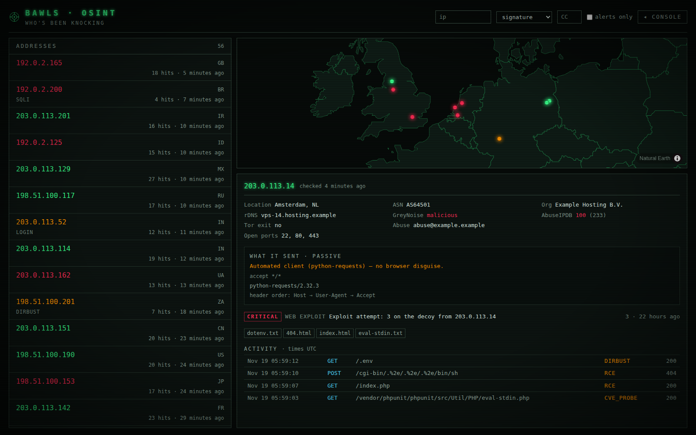
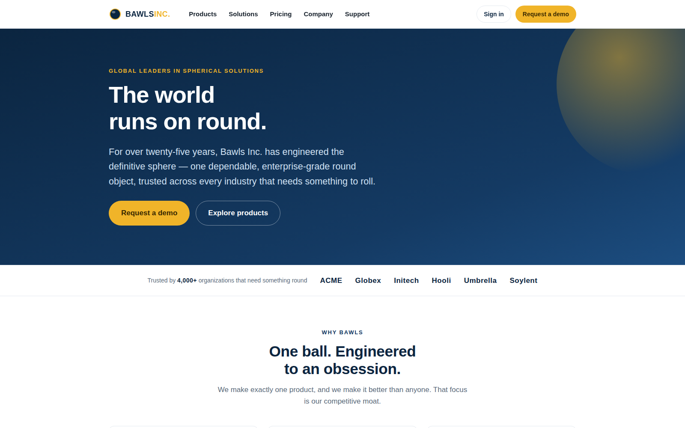
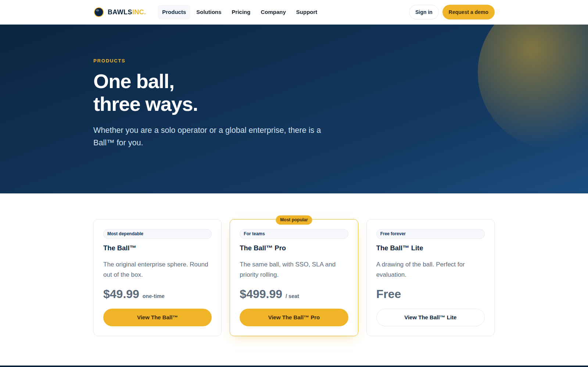

<h1 align="center">bawls</h1>

<p align="center"><strong>A decoy website that bans the attackers it catches.</strong></p>

<p align="center">
A self-hosted honeypot for any Linux server you have root on. Scanners and exploit bots that hit
your bare IP or a spare domain land on a fake company's website. bawls records what they try,
looks up who they are, and blocks the worst of them at the firewall, for every site on the server.
</p>


<p align="center"><sub>Screenshots use fictional demo data from the documentation IP ranges, not real attackers.</sub></p>

---

## What it is

Every server on the internet is probed around the clock: bots try `/.env`, WordPress logins,
phpMyAdmin, old CVEs, SQL injection, SSH passwords. Most of it lands on 404 pages and is never seen.

bawls puts something there for them to find. Requests for your server's bare IP, for unknown
hostnames, or for a domain you set aside get a convincing (and slightly absurd) corporate website,
plus fake versions of the files and logins attackers look for. Every request is recorded, with
what the client sent and what it tried. Anything that sends a real exploit is banned from the
whole server for a week, on every port, so your real sites never see it again.

It all goes into a private console only you can reach. One install script sets it all up next to
the sites you already run, on Apache or nginx.

## Features

- **A decoy that looks real**: a full fake company website (Bawls Inc.: *Global Leaders in
  Spherical Solutions*) with products, pricing, press and careers pages, served to the bare IP,
  unknown hostnames, or a domain of your choice. Swap in your own theme so it looks like anything.
- **Bait where attackers look**: fake WordPress and phpMyAdmin logins, a leaked `.env`,
  `.git/config`, AWS keys, an SSH key, Spring actuator and server-status pages, the PHPUnit
  `eval-stdin.php` probe. All fake, and every visit is recorded.
- **Bans on every port**: an exploit attempt (SQL injection, remote code execution, path
  traversal, a known-CVE probe) gets the source banned by fail2ban for 7 days, firewall-wide.
  Your own IP and the server's addresses are never banned.
- **Detections**: port scans, host sweeps, floods, brute force against SSH, RDP, Telnet,
  SMB, FTP and databases, web scans and exploit attempts, raised as alerts you can
  acknowledge or resolve.
- **A firewall sensor**: if UFW is on, the connections it blocks are recorded too.
- **Dossiers on attackers**: country, city and network from MaxMind GeoLite2 (looked up on your
  server), reverse DNS, RDAP, AbuseIPDB, GreyNoise, Shodan InternetDB and the Tor exit list,
  pinned on a map that's bundled with bawls, so nothing about what you look at goes to a map
  provider.
- **What they typed**: every username and password sprayed at the fake logins. Passwords off the
  common-password list are reduced to their length and never stored.
- **A console nobody else can find**: a private hostname, an IP allowlist, a secret sign-in path
  (everything else answers 404) and a strict Content Security Policy.
- **Alerts where you are**: new high-severity alerts are posted to a webhook (ntfy, Slack,
  Discord, anything that takes JSON).
- **A blocklist feed**: a plain-text list of alerted addresses for your other firewalls.
- **One installer**: Apache or nginx, Let's Encrypt, upgrades that roll back on failure, a health
  check and a clean uninstall.

## The console

<table>
<tr>
<td width="50%"><br><sub>OSINT: every address that knocked, on a map</sub></td>
<td width="50%"><br><sub>A dossier: network, reputation, what the client sent and everything it tried</sub></td>
</tr>
<tr>
<td width="50%"><br><sub>Credentials sprayed at the fake logins</sub></td>
<td width="50%"><br><sub>Settings: your time zone and the console's accent colour</sub></td>
</tr>
</table>

## The decoy

<table>
<tr>
<td width="50%"><br><sub>Bawls Inc., the default theme</sub></td>
<td width="50%"><br><sub>About twenty interlinked pages, so it holds up when someone clicks around</sub></td>
</tr>
</table>

The decoy is a small Python program (standard library only) that runs as its own unprivileged
user in a tight systemd sandbox. It can't see your other sites, the console's files or any
home directory, and it only listens on `127.0.0.1` behind your web server. Every response is static,
so there is nothing for an attacker to actually exploit.

## Install

### Requirements

- A Debian or Ubuntu server with systemd, and root access. Tested on Ubuntu 26.04, Debian 12 and
  Debian 13.
- Apache or nginx; Apache is installed if neither is.
- PHP 8.4.1 or newer with FPM, Python 3.10 or newer, and fail2ban for bans. The installer adds
  whatever is missing with apt and never upgrades what's already there.

### Quick start

Download the latest `bawls-<version>.tar.gz` and its `.sha256` from [Releases](../../releases),
then:

```bash
sha256sum -c bawls-<version>.tar.gz.sha256
tar -xzf bawls-<version>.tar.gz && cd bawls
cp bawls.conf.example bawls.conf
nano bawls.conf                     # at least CONSOLE_HOST and DECOY_MODE
sudo ./install.sh --config bawls.conf
```

The installer prints each change it makes, then runs a set of checks. When it finishes:

1. Add the hosts-file line it printed (`<server IP>  <CONSOLE_HOST>`) on each computer you'll use
   the console from. The console's hostname isn't in DNS, on purpose.
2. Read your sign-in path and password with `sudo cat /root/bawls-console.txt`.
3. Open `https://<CONSOLE_HOST>/<sign-in path>`. The certificate is self-signed, so your browser
   warns once.

Releases include everything they need (`vendor/` and the built front end), so the server needs
neither Composer nor Node.

### Configuration

Everything lives in `/etc/bawls/bawls.conf`, which the installer keeps (root-only). To change
something, edit it and run `sudo /var/www/bawls/install.sh` again. It only touches what changed,
and a config with a mistake is refused before it replaces the working one.

| Setting | Default | What it does |
|---|---|---|
| `INSTALL_DIR` | `/var/www/bawls` | Where the app lives. Its parent folder is hidden from the decoy. |
| `WEB_SERVER` | `auto` | `apache` or `nginx`; `auto` uses whichever the server runs. |
| `CONSOLE_HOST` | `bawls.admin` | The console's private hostname. Pick something unguessable. |
| `CONSOLE_ALLOW` | your SSH IP | Addresses (or CIDR ranges) allowed to reach the console. |
| `ADMIN_EMAIL` | `admin@<CONSOLE_HOST>` | The console login. Its password is generated for you. |
| `DECOY_MODE` | `catchall` | Where the decoy answers: `catchall`, `domain` or `both`. |
| `DECOY_DOMAINS` | | The decoy's domain(s), for `domain` and `both`. |
| `REPLACE_DEFAULT_VHOST` | `no` | Allow taking over a default site you've customised. |
| `LETSENCRYPT` | `no` | `yes` gets a certificate for `DECOY_DOMAINS`; certbot renews it. |
| `LETSENCRYPT_EMAIL` | | Optional contact address for your Let's Encrypt account. |
| `THEME` | `bawls-inc` | A theme name, or the path to your own theme folder. |
| `BAN` | `yes` | Ban exploit attempts on every port with fail2ban. |
| `BAN_TIME` | `7d` | How long a ban lasts (`12h`, `7d`, ...). |
| `NEVER_BLOCK` | | Addresses never to ban. Yours and the server's are always added. |
| `UFW_SENSOR` | `auto` | Record UFW's blocks; `auto` means only if UFW is active. |
| `MAXMIND_LICENSE_KEY` | | A free key from MaxMind adds country, city and network. |
| `ALERT_WEBHOOK` | | Where to post new high-severity alerts. |
| `INSTALL_PACKAGES` | `yes` | Install missing packages with apt; `no` lists them and stops. |
| `PHP_VERSION` | | Which PHP to use (e.g. `8.5`) when the server has several. |
| `DECOY_PORT`, `INGEST_PORT` | `8088`, `9119` | Internal ports, on `127.0.0.1` only. |

Optional API keys for the dossiers (`ABUSEIPDB_KEY`, `GREYNOISE_KEY`) go in
`/var/www/bawls/.env`; the installer leaves them alone.

### Where the decoy answers

- **`catchall`** (recommended): anything that isn't one of your named sites. That means
  the bare IP, junk `Host` headers and most scanners. Your real sites keep answering their own
  names exactly as before. Debian's stock default page is replaced freely; a default site you
  made yourself is only taken over with `REPLACE_DEFAULT_VHOST=yes`, and comes back if you
  uninstall.
- **`domain`**: only the domains in `DECOY_DOMAINS`, over HTTPS if `LETSENCRYPT=yes`.
- **`both`**: the two together.

### Console access

The console only answers its private hostname, from the addresses in `CONSOLE_ALLOW`, and only
at the secret sign-in path; everything else gets a 404. If your IP changes, SSH in from the new
one and run:

```bash
sudo /var/www/bawls/install.sh --allow-my-ip
```

That sets the allowlist to the IP you're connected from, and the never-ban list follows. From
anywhere else, an SSH tunnel works too. `127.0.0.1` is always allowed:

```bash
ssh -L 8443:127.0.0.1:443 you@your-server
# then open https://<CONSOLE_HOST>:8443/<sign-in path>, with <CONSOLE_HOST> -> 127.0.0.1 in your hosts file
```

### Bans

Only exploit attempts ban by default, because they need a real attack payload, so a curious
visitor clicking around never gets banned. Bans are kept in fail2ban's database and survive a
restart.

```bash
sudo fail2ban-client status bawls              # who is banned right now
sudo fail2ban-client set bawls unbanip <ip>    # lift one
```

### Themes

A theme is a folder of static files plus a `theme.json` that maps clean URLs to them:

```json
{
    "name": "Acme Widgets",
    "pages": { "/": "index.html", "/about": "about.html", "/robots.txt": "robots.txt" },
    "not_found": "404.html",
    "unavailable": "503.html"
}
```

In `.txt` and `.xml` pages, `{{origin}}` becomes `https://` plus the hostname the visitor asked
for, so a `robots.txt` or `sitemap.xml` can name the site without hard-coding a domain.

Put it outside `INSTALL_DIR` (upgrades replace that folder) and set `THEME=/srv/acme-theme`. The
installer checks the theme before switching to it. The bait pages stay the same whatever the
theme: a fake WordPress login has to look like WordPress. Bawls Inc. is public, so anyone who
knows bawls can recognise it. Your own theme makes the decoy harder to spot.

### Upgrade, check, uninstall

```bash
sudo ./install.sh                          # from a newer release: upgrade
sudo /var/www/bawls/install.sh --check     # health check; changes nothing
sudo /var/www/bawls/install.sh --uninstall           # remove bawls, keep its data
sudo /var/www/bawls/install.sh --uninstall --purge   # remove everything, data included
```

Before an upgrade, the installer backs up the code, database, `.env` and config. If anything
fails, it puts the previous version back by itself. An uninstall takes out the services, sites,
self-signed certificates and the fail2ban jail, and gives back any default site it took over.
`--purge` also deletes the Let's Encrypt certificate.

## Privacy

bawls is built to study attackers, not visitors.

- It records requests to the decoy and nothing else on your server.
- It reads only what a client sends anyway: headers, paths and form fields. The decoy runs no
  tracking or fingerprinting scripts.
- Only suspicious addresses are looked up, never ordinary visitors, and only through passive
  sources: no scans, no contact with the address itself.
- Typed passwords are kept only if they are on the common-password list; anything else is
  reduced to its length.
- Ordinary page views, and firewall blocks from addresses that never raised an alert, are
  deleted after 7 days. Attack evidence is kept for 180 days; alerts you haven't reviewed are
  never deleted.
- The optional `/browser-check` page is a fingerprinting self-test that runs only when a
  visitor clicks to start it, after a clear notice. It is off unless you turn it on
  (`php artisan bawls:browser-check on`).

## Development

```bash
composer install && npm ci && npm run build
cp .env.example .env && php artisan key:generate   # then set BAWLS_LOGIN_PATH to a secret slug
php artisan migrate
php artisan db:seed --class=DemoSeeder              # a fictional day of attacks (empty database only)
php artisan bawls:user you@example.com              # a console login
php artisan serve

php artisan test                                    # PHP tests
(cd sensors && pipx run pytest -q)                  # decoy and UFW sensor tests
deploy/build-release.sh                             # dist/bawls-<version>.tar.gz
```

The demo data uses only the IPv4 documentation ranges (RFC 5737) and documentation AS numbers
(RFC 5398), so none of it points at a real host.

## Built with

Laravel · Inertia · Vue 3 · Tailwind CSS · SQLite · MapLibre GL · MaxMind GeoLite2 · Python ·
fail2ban · Apache or nginx

## License

Copyright © 2026 rocketskatesninja.

bawls is free software under the [GNU Affero General Public License v3.0](LICENSE). You may run,
study, share and change it. If you share a changed version, or run one that people reach over a
network, you must make its source available to them under the same licence.

---

<p align="center"><sub>bawls · AGPL-3.0</sub></p>
